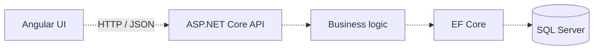

# FusionStack

**Angular + ASP.NET Core business application workspace**

FusionStack is a workspace for an enterprise-oriented full-stack business application. Its intended direction is a modular Angular frontend connected to an ASP.NET Core backend and relational persistence.

> **Current status:** the public snapshot contains configuration files, a solution file, and documentation. It does not yet contain the Angular `src/` tree or the .NET project directories referenced by the solution. The design below describes the intended architecture, rather than completed, runnable features.

## Problem and direction

Business applications need a consistent connection between dashboards, forms, API contracts, and persistence. FusionStack's intended design separates presentation, application rules, and data access so those responsibilities can evolve independently.

For implemented portfolio examples, see the [Enterprise ERP frontend](https://github.com/HamzaDee/fullstack-angular-dotnet-ERP-System) and [Customer Statement API](https://github.com/HamzaDee/CustomerStatement).

## Intended architecture



Dashed arrows indicate the intended design; application implementations are not included in this snapshot.

## Technologies and contents

| File / technology | What is present |
| --- | --- |
| `package.json` | Angular 12, TypeScript, RxJS, UI/charting dependency declarations and scripts |
| `angular.json` | Angular workspace/build configuration |
| `ERPAngularAPI.sln` | .NET solution references; the referenced projects are not included |
| `LICENSE` | Repository license terms |

ASP.NET Core, EF Core, and SQL Server belong to the intended backend design. There are no backend endpoint implementations in this snapshot.

## Planned capabilities

- Modular business screens and reusable forms.
- Dashboards backed by application APIs.
- Separate API contracts, business logic, and persistence.
- Consistent validation and error responses.

These capabilities are a roadmap, not an assertion of shipped functionality.

## Running the project

The current snapshot cannot run as a standalone application. The source trees and referenced .NET projects must first be restored.

The manifest declares these commands for a complete frontend checkout:

```bash
npm install
npm start
npm run build
```

They are not a working quick start for this snapshot. A complete checkout will also need a documented Node.js version, backend launch instructions, local connection configuration, and synthetic seed data. There are currently no implemented API routes to list here.

## Architecture decisions to carry into implementation

| Decision | Intended benefit |
| --- | --- |
| Angular with an HTTP API boundary | Separate UI behavior from server-side business rules. |
| ASP.NET Core application layer | Centralize validation and business workflows. |
| EF Core with SQL Server | Use relational persistence and controlled schema evolution. |
| Domain-based modules | Keep related workflows together as the application grows. |

---

[Hamza Naghnaghieh](https://github.com/HamzaDee) · **Full-Stack Software Engineer | 7 years**
